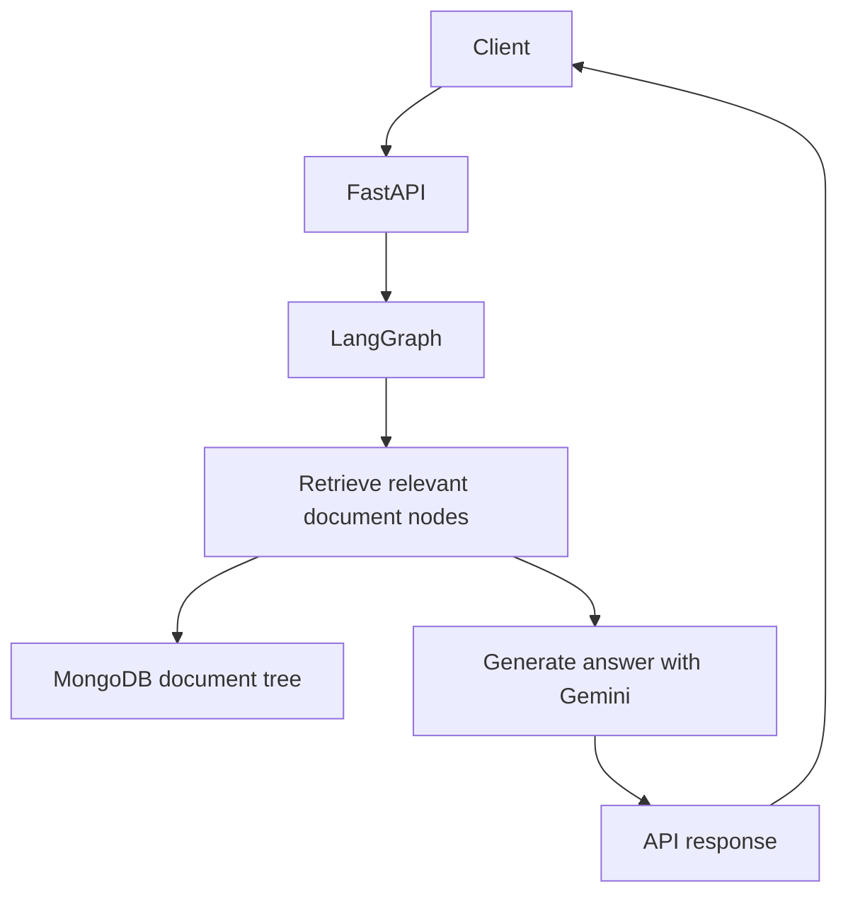

# Architecture

The application is a small FastAPI service that invokes a LangGraph workflow.
The workflow retrieves relevant passages from a PageIndex document tree stored
in MongoDB, then asks Gemini to answer using those passages.

## Runtime and data flow

Documents are indexed separately with `python -m prep.index_docs`. The script
sends a PDF to PageIndex and stores its document tree in MongoDB. At request
time, the retrieval node asks Gemini to select relevant nodes from that tree;
the generation node uses their text as answer context.

## Services

| Service | Responsibility |
|---|---|
| `app` | FastAPI endpoint and LangGraph workflow |
| `mongodb` | Stores PageIndex document trees |
| PageIndex | Converts support PDFs into searchable document trees |
| Google Gemini | Selects relevant tree nodes and generates answers |
